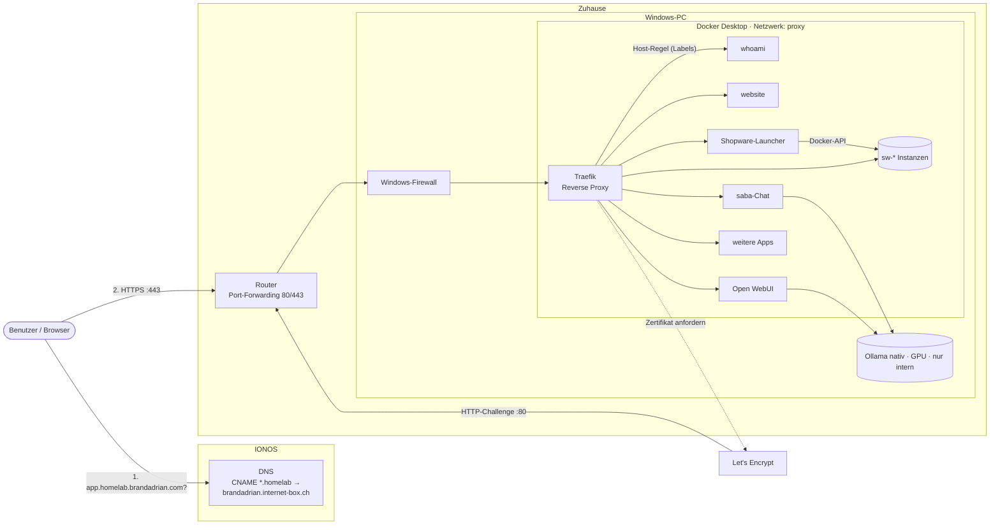

# homelab-proxy

Öffentliche Docker-Apps auf einem Windows-Rechner hosten, mit **Traefik** als Reverse Proxy und automatischem HTTPS (Let's Encrypt).

## Inhalt

- [System Context](#system-context)
- [Struktur](#struktur)
- [Voraussetzungen](#voraussetzungen)
- [Quickstart](#quickstart)
- [Dokumentation](#dokumentation)

## System Context



## Struktur

```
traefik/   Reverse Proxy (läuft einmal)
whoami/    Beispiel-App (zeigt Request-Infos)
website/   Beispiel-App (statische HTML-Seite mit nginx)
saba/      Einfacher Chat mit lokalem Modell (Ollama nativ unter Windows)
openwebui/ Chat und Modellverwaltung mit Login (Open WebUI)
shopware-launcher/  Web-App zum Starten von Shopware-Instanzen (dockware)
shopware-launcher-dotnet/  dasselbe in ASP.NET Core 10 (nur eine Variante laufen lassen)
docs/      Detail-Dokumentation
```

## Voraussetzungen

- Windows mit Docker Desktop (WSL2)
- Domain `brandadrian.com` bei IONOS
- Swisscom Internet-Box mit DynDNS-Name `brandadrian.internet-box.ch`
- Echte öffentliche IPv4 (kein DS-Lite, sonst funktioniert Port-Forwarding nicht)

## Quickstart

1. **DNS:** IONOS-CNAME `*.homelab` → `brandadrian.internet-box.ch` → [docs/dns-ionos.md](docs/dns-ionos.md)
2. **Router:** feste IP `192.168.1.117`, Portweiterleitung 80/443 → [docs/router-swisscom.md](docs/router-swisscom.md)
3. **DynDNS:** in der Internet-Box aktiv → [docs/dyndns.md](docs/dyndns.md)
4. **Windows-Firewall** 80/443 öffnen → [docs/windows-docker.md](docs/windows-docker.md)
5. **Starten:**

```bash
docker network create proxy        # einmalig, vor dem ersten Start!

cd traefik && docker compose up -d
cd ../whoami && docker compose up -d
cd ../website && docker compose up -d
```

6. **Testen:** Handy ohne WLAN → https://website.homelab.brandadrian.com, lokal → https://website.localhost

Nach Änderungen an Labels immer: `docker compose up -d --force-recreate`

## Dokumentation

| Thema | Datei |
|-------|-------|
| IONOS DNS | [docs/dns-ionos.md](docs/dns-ionos.md) |
| Router / Portweiterleitung | [docs/router-swisscom.md](docs/router-swisscom.md) |
| DynDNS | [docs/dyndns.md](docs/dyndns.md) |
| Firewall, Docker-Netzwerk, Konfiguration, Starten, Testen | [docs/windows-docker.md](docs/windows-docker.md) |
| Lokal testen (`*.localhost`) | [docs/lokal-testen.md](docs/lokal-testen.md) |
| Neue App hinzufügen | [docs/neue-app.md](docs/neue-app.md) |
| Saba-Chat mit lokalem Modell | [docs/saba.md](docs/saba.md) |
| Open WebUI (Chat und Modelle verwalten) | [docs/openwebui.md](docs/openwebui.md) |
| Shopware-Launcher | [docs/shopware-launcher.md](docs/shopware-launcher.md) |
| Shopware-Launcher (.NET) | [docs/shopware-launcher-dotnet.md](docs/shopware-launcher-dotnet.md) |
| Troubleshooting | [docs/troubleshooting.md](docs/troubleshooting.md) |
