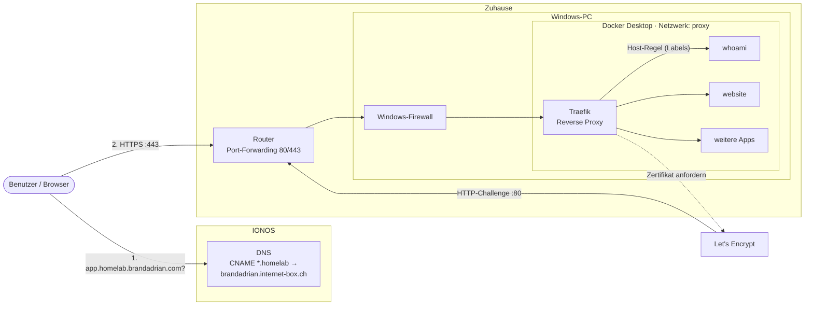

# homelab-proxy

Öffentliche Docker-Apps auf einem Windows-Rechner hosten, mit **Traefik** als Reverse Proxy und automatischem HTTPS (Let's Encrypt).

## System Context



## Struktur

```
traefik/   Reverse Proxy (läuft einmal)
whoami/    Beispiel-App (zeigt Request-Infos)
website/   Beispiel-App (statische HTML-Seite mit nginx)
```

## Voraussetzungen

- Windows mit Docker Desktop (WSL2)
- Domain `brandadrian.com` bei IONOS
- Swisscom Internet-Box mit DynDNS-Name `brandadrian.internet-box.ch`
- Echte öffentliche IPv4 (kein DS-Lite, sonst funktioniert Port-Forwarding nicht)

## Setup

### 1. IONOS DNS

Apps laufen unter `<app>.homelab.brandadrian.com`. Dafür reicht **ein** Eintrag in der IONOS Domain-Verwaltung:

| Typ   | Host        | Zeigt auf |
|-------|-------------|-----------|
| CNAME | `*.homelab` | `brandadrian.internet-box.ch` |

`brandadrian.internet-box.ch` ist der DynDNS-Name der Swisscom Internet-Box und zeigt immer auf die aktuelle öffentliche IP. Kein A-Record und kein eigenes DynDNS nötig.

Durch die Wildcard funktioniert jede neue App (`website.homelab.brandadrian.com`, ...) ohne weiteren DNS-Eintrag.

Ein bestehender `A *`-Record auf der Hauptdomain stört nicht (`*.homelab` ist spezifischer), wird für das Homelab aber auch nicht gebraucht.

Prüfen: `nslookup website.homelab.brandadrian.com` → muss auf `brandadrian.internet-box.ch` bzw. deine öffentliche IP zeigen. DNS-Änderungen können bis zu 1 h (TTL) dauern.

### 2. Router (Swisscom Internet-Box)

1. **DHCP-Reservierung:** Dem Windows-PC fest die IP `192.168.1.117` geben (in der Weboberfläche der Internet-Box, http://192.168.1.1).
2. **Portweiterleitung** in der Internet-Box, Protokoll TCP:

| Externer Port | Ziel | Interner Port |
|---------------|------|---------------|
| 80  | `192.168.1.117` | 80  |
| 443 | `192.168.1.117` | 443 |

Port 80 wird für die Let's-Encrypt-HTTP-Challenge gebraucht (und leitet danach auf HTTPS um).

### 3. DynDNS (Swisscom Internet-Box)

Die öffentliche IP von Swisscom ändert sich gelegentlich. Damit die Domain trotzdem stimmt:

1. In der Internet-Box DynDNS aktivieren (Weboberfläche → Netzwerk / Einstellungen → DynDNS).
2. Hostname: `brandadrian.internet-box.ch`. Die Box aktualisiert diesen Namen automatisch bei jeder IP-Änderung.
3. Bei IONOS zeigt der CNAME `*.homelab` auf diesen Namen (siehe Schritt 1). Deshalb ist **kein A-Record mit fester IP** nötig.

```
Browser → website.homelab.brandadrian.com
        → CNAME brandadrian.internet-box.ch   (IONOS)
        → aktuelle öffentliche IP              (Swisscom DynDNS)
        → Internet-Box → 192.168.1.117:443 → Traefik
```

Prüfen:

```powershell
nslookup brandadrian.internet-box.ch          # muss deine aktuelle öffentliche IP liefern
nslookup website.homelab.brandadrian.com      # muss auf brandadrian.internet-box.ch zeigen
```

Öffentliche IP vergleichen: https://ifconfig.me

### 4. Windows-Firewall

PowerShell als Administrator:

```powershell
New-NetFirewallRule -DisplayName "HTTP 80"  -Direction Inbound -Protocol TCP -LocalPort 80  -Action Allow
New-NetFirewallRule -DisplayName "HTTPS 443" -Direction Inbound -Protocol TCP -LocalPort 443 -Action Allow
```

### 5. Docker-Netzwerk (Pflicht, vor dem ersten Start!)

> ⚠️ **Muss einmalig ausgeführt werden, bevor du `docker compose up -d` startest.** Sonst kommt `network proxy not found`.

```bash
docker network create proxy
```

Prüfen: `docker network ls` → `proxy` muss in der Liste sein.

### 6. Konfigurieren

- `traefik/docker-compose.yml`: E-Mail für Let's Encrypt (`acme.email`, aktuell `brandadrian@gmail.com`). Wird nur für Ablauf-/Problem-Warnungen der Zertifikate verwendet.

> Wird die E-Mail geändert: `traefik/letsencrypt/acme.json` löschen und Traefik mit `docker compose up -d --force-recreate` neu starten. Sonst bleibt der alte ACME-Account mit der alten Mail gespeichert.

### 7. Starten

```bash
cd traefik
docker compose up -d

cd ../whoami
docker compose up -d

cd ../website
docker compose up -d
```

### 8. Testen

- Lokal: https://website.localhost (siehe „Lokal testen“)
- Von außen: **Handy mit WLAN aus** (mobile Daten) → `https://website.homelab.brandadrian.com` und `https://whoami.homelab.brandadrian.com`. Aus dem eigenen WLAN klappt der Aufruf der öffentlichen Domain je nach Router nicht (NAT-Loopback), das ist kein Fehler.
- Zertifikat: Schloss im Browser muss „Let's Encrypt“ zeigen. Das erste Zertifikat kann nach dem Start ca. 1 Minute dauern.

### Labels geändert? → neu erstellen

Traefik liest Labels nur beim Erstellen des Containers. Nach jeder Änderung an einer `docker-compose.yml`:

```bash
docker compose up -d --force-recreate
```

HTML ändern: einfach `website/html/index.html` bearbeiten, nginx liefert die Änderung sofort aus (kein Neustart nötig).

Logs bei Problemen: `docker logs traefik`

## Lokal testen

Ohne Domain, DNS und Port-Forwarding, direkt auf dem PC:

1. `docker network create proxy` (falls noch nicht passiert)
2. `traefik`, `whoami` und `website` mit `docker compose up -d` starten
3. Im Browser öffnen:
   - https://website.localhost
   - https://whoami.localhost

Die **Zertifikatswarnung ist normal**: Let's Encrypt stellt für `localhost` keine Zertifikate aus, Traefik nimmt ein selbstsigniertes. Im Browser „Trotzdem fortfahren“ klicken.

Dafür hat jede App einen zweiten Router `<app>-local` mit `tls=true` **ohne** `certresolver`. `*.localhost` darf nie im selben Router wie die echte Domain stehen, sonst lehnt Let's Encrypt das ganze Zertifikat ab (`Cannot issue for "...localhost"`).

`*.localhost` zeigt in Chrome/Edge/Firefox automatisch auf `127.0.0.1`, ein Eintrag in der `hosts`-Datei ist nicht nötig.

## Neue App hinzufügen

1. Neuen Ordner anlegen, z.B. `meineapp/`
2. `docker-compose.yml` mit Netzwerk `proxy` und Traefik-Labels:

```yaml
services:
  meineapp:
    image: dein/image
    restart: unless-stopped
    labels:
      - traefik.enable=true
      - traefik.http.routers.meineapp.rule=Host(`meineapp.homelab.brandadrian.com`)
      - traefik.http.routers.meineapp.entrypoints=websecure
      - traefik.http.routers.meineapp.tls.certresolver=le
      - traefik.http.routers.meineapp.service=meineapp
      # optional lokal: https://meineapp.localhost
      - traefik.http.routers.meineapp-local.rule=Host(`meineapp.localhost`)
      - traefik.http.routers.meineapp-local.entrypoints=websecure
      - traefik.http.routers.meineapp-local.tls=true
      - traefik.http.routers.meineapp-local.service=meineapp
      - traefik.http.services.meineapp.loadbalancer.server.port=8080  # interner Port der App
    networks:
      - proxy

networks:
  proxy:
    external: true
```

3. `docker compose up -d`

Router-Name (`meineapp`) muss pro App eindeutig sein. Kein DNS-Eintrag nötig (Wildcard), keine Änderung an Traefik.

## Troubleshooting

### Browser zeigt `404 page not found`

Die Seite kommt von Traefik, aber kein Router passt auf den Host. Meist läuft der Container noch mit alten Labels → im App-Ordner `docker compose up -d --force-recreate`. Prüfen mit `docker logs traefik` (dort steht die aktuelle `rule=`).

### `acme: error: 403 ... Invalid response from http://.../.well-known/acme-challenge/...`

Let's Encrypt erreicht Port 80 nicht. Prüfen: DNS-Eintrag (`nslookup`), Portweiterleitung 80 → `192.168.1.117`, Windows-Firewall.

### Port 80 vom Provider gesperrt / belegt → TLS-Challenge

Statt HTTP-Challenge (Port 80) kann Traefik das Zertifikat über Port 443 holen. In `traefik/docker-compose.yml`:

```yaml
      # - --certificatesresolvers.le.acme.httpchallenge.entrypoint=web
      - --certificatesresolvers.le.acme.tlschallenge=true
```

Danach `acme.json` löschen und Traefik neu erstellen (`docker compose up -d --force-recreate`).

### `Cannot issue for "....localhost": Domain name does not end with a valid public suffix`

`*.localhost` steht im selben Router wie die echte Domain. Lokalen Host in einen eigenen Router ohne `certresolver` auslagern (siehe „Lokal testen“).

### `Error response from daemon: network proxy not found`

Das Docker-Netzwerk `proxy` existiert noch nicht. Einmalig anlegen und neu starten:

```bash
docker network create proxy
docker compose up -d
```

Das Netzwerk bleibt auch nach einem Neustart von Docker Desktop erhalten.
