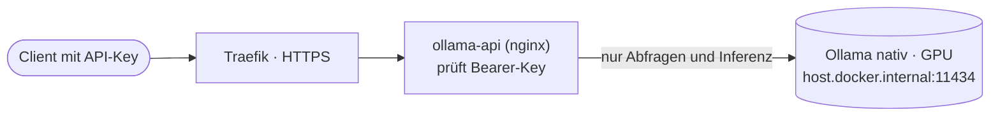

# Ollama-API von aussen

[← zurück zur README](../README.md)

Direkter Zugriff auf die lokalen Modelle (z.B. aus VS Code, Skripten, anderen Apps), abgesichert mit einem API-Key (GUID). Ollama selbst hat keine Auth, deshalb steht nginx davor und prüft den Key.

- Öffentlich: https://ollama.homelab.brandadrian.com
- Lokal: https://ollama.localhost



## Dateien

```
ollama-api/docker-compose.yml                nginx + Traefik-Labels
ollama-api/templates/default.conf.template   Key-Prüfung und erlaubte Endpunkte
ollama-api/.env.example                      Vorlage für den Key
ollama-api/.env                              der echte Key (nicht im Git)
```

## Starten

`.env` aus `.env.example` erstellen, Key setzen (PowerShell: `[guid]::NewGuid()`), dann:

```bash
docker compose up -d
```

Key ändern: `.env` anpassen, dann `docker compose up -d --force-recreate`.

## Benutzen

Header `Authorization: Bearer <Key>` mitschicken.

```bash
curl https://ollama.homelab.brandadrian.com/api/tags -H "Authorization: Bearer <Key>"

curl https://ollama.homelab.brandadrian.com/api/chat -H "Authorization: Bearer <Key>" \
  -d '{"model":"gemma3:12b","messages":[{"role":"user","content":"Hallo"}]}'
```

PowerShell (`curl` ist dort ein Alias für `Invoke-WebRequest`, deshalb `curl.exe` oder):

```powershell
Invoke-RestMethod https://ollama.homelab.brandadrian.com/api/tags -Headers @{ Authorization = "Bearer <Key>" }
```

OpenAI-kompatible Clients: Base-URL `https://ollama.homelab.brandadrian.com/v1`, API-Key = der Key.

GitHub Copilot (VS Code): Chat: Manage Language Models → OpenAI Compatible → Base-URL `https://ollama.homelab.brandadrian.com/v1`, API-Key, Modell-ID (z.B. `qwen2.5-coder:14b`).

Die `ollama`-CLI (`OLLAMA_HOST=...`) kann keinen Header mitschicken und funktioniert deshalb nicht von aussen.

## Erlaubte Endpunkte

| Ollama | OpenAI-kompatibel |
|--------|-------------------|
| `/api/chat`, `/api/generate`, `/api/embed`, `/api/embeddings` | `/v1/chat/completions`, `/v1/completions`, `/v1/embeddings` |
| `/api/tags`, `/api/show`, `/api/ps`, `/api/version` | `/v1/models` |

`/api/models`, `/api/chat/completions` und `/api/completions` werden auf `/v1/...` umgeleitet, weil GitHub Copilot diese Pfade aufruft.

Gesperrt (404): `pull`, `push`, `create`, `copy`, `delete`, `blobs`. Modelle verwalten nur lokal oder über [Open WebUI](openwebui.md).

## Sicherheit

- Ohne gültigen Key: `401`.
- Nur über HTTPS erreichbar (Traefik leitet HTTP auf HTTPS um).
- Der Key wird nicht an Ollama weitergegeben.
- Key nie ins Repo schreiben. Bei Verdacht neuen Key erzeugen.
