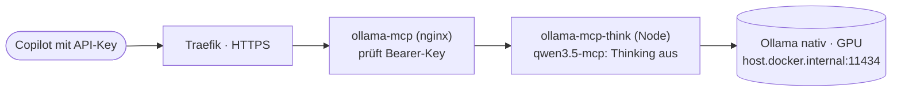

# Ollama für MCP-Agenten (ohne Thinking)

[← zurück zur README](../README.md)

Eigener Zugang für Agenten, die viele Tool-Calls machen (z.B. GitHub Copilot: Elasticsearch → Loki → GitLab). Gleicher API-Key wie [ollama-api](ollama-api.md), aber dazwischen sitzt ein kleiner `think-proxy`: Für das Modell `qwen3.5-mcp` schaltet er Thinking ab. Copilot kann das nicht selbst, und ein Modelfile auch nicht. Alle anderen Modelle gehen unverändert durch.

- Öffentlich: https://ollama-mcp.homelab.brandadrian.com
- Lokal: https://ollama-mcp.localhost



Warum ohne Thinking: Bei einem Agenten läuft Thinking in jeder Tool-Runde neu. Mit ~40k Tokens Prompt (Copilot-Systemprompt + Tool-Definitionen) dauert eine Runde mit Thinking schnell über 2 Minuten, und Copilot bricht ab. Ohne Thinking: ~29 s beim ersten Mal, danach wenige Sekunden (Prompt-Cache).

## Dateien

```
ollama-mcp/docker-compose.yml                nginx + think-proxy + Traefik-Labels
ollama-mcp/templates/default.conf.template   Key-Prüfung und erlaubte Endpunkte (wie ollama-api)
ollama-mcp/think-proxy/server.mjs            setzt "think": false bzw. "reasoning_effort": "none"
```

Der Key kommt aus `ollama-api/.env` (keine Kopie).

Das Modell `qwen3.5-mcp` (Basis `qwen3.5:9b`, temperature 0.3, 131072 Kontext, Agent-Systemprompt) muss lokal existieren:

```bash
ollama create qwen3.5-mcp -f C:\github\ollama-monitor\models\qwen3.5-mcp.Modelfile
```

## Starten

```bash
cd ollama-mcp && docker compose up -d
```

Kein DNS-Eintrag nötig (Wildcard `*.homelab`), das Let's-Encrypt-Zertifikat holt Traefik beim ersten Aufruf.

Weitere Modelle ohne Thinking: `NO_THINK_MODELS` in `docker-compose.yml` ergänzen (kommagetrennt), dann `docker compose up -d`.

## Was der think-proxy ändert

| Pfad | nur wenn `model` in `NO_THINK_MODELS` |
|------|---------------------------------------|
| `/api/chat`, `/api/generate` | `"think": false` |
| `/v1/chat/completions`, `/v1/completions` | `"reasoning_effort": "none"` (`think` wird dort von Ollama ignoriert) |

Alles andere (auch Streaming) geht unverändert und ungepuffert durch. Bricht der Client ab, wird auch die Ollama-Anfrage abgebrochen.

## GitHub Copilot (VS Code)

1. Chat: Manage Language Models → OpenAI Compatible → Base-URL `https://ollama-mcp.homelab.brandadrian.com/v1`, API-Key, Modell-ID `qwen3.5-mcp`.
2. Im Agent-Modus `qwen3.5-mcp` wählen.
3. Im Chat auf das Werkzeug-Symbol (Configure Tools) und nur die nötigen Tools aktiv lassen (Elasticsearch, Loki, GitLab). Jede Tool-Beschreibung macht den Prompt grösser und langsamer.

## Testen

```bash
curl https://ollama-mcp.homelab.brandadrian.com/v1/chat/completions -H "Authorization: Bearer <Key>" \
  -d '{"model":"qwen3.5-mcp","messages":[{"role":"user","content":"Hallo"}]}'
```

In der Antwort darf kein `reasoning`-Feld stehen. Log des Proxys: `docker compose logs ollama-mcp-think` (Zeile `no-think ... model=qwen3.5-mcp`).

## Zurück

```bash
cd ollama-mcp && docker compose down
```

`ollama-api` ist davon nicht betroffen.
