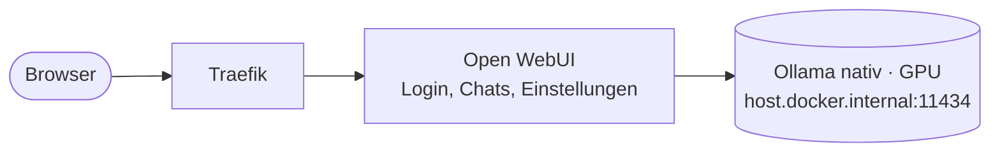

# Open WebUI – Chat und Modellverwaltung mit Login

[← zurück zur README](../README.md)

Chat-Oberfläche für die lokalen Modelle, inklusive Modelle anzeigen, installieren und löschen. Die Modelle laufen in [Ollama](saba.md) nativ unter Windows.

- Öffentlich: https://openwebui.homelab.brandadrian.com
- Lokal: https://openwebui.localhost



## Dateien

```
openwebui/docker-compose.yml   Open WebUI + Traefik-Labels
openwebui/.env.example         Vorlage für die Secrets
openwebui/.env                 Admin-Login und Session-Key (nicht im Git)
```

Benutzer, Chats und Einstellungen liegen im Docker-Volume `openwebui_data`.

## Starten

`.env` aus `.env.example` erstellen und ausfüllen, dann:

```bash
docker compose up -d
```

Der Admin wird beim ersten Start aus der `.env` angelegt. So gibt es keinen Moment, in dem sich ein Fremder als erster Benutzer registrieren und Admin werden könnte.

## Modelle verwalten

Als Admin unter Admin-Einstellungen → Modelle:

- **Anzeigen:** Liste aller Modelle in Ollama.
- **Installieren / Löschen:** Das wirkt direkt auf Ollama, also auch auf Saba. Das Modell `saba` nicht löschen.
- **Beschreibung:** Modell bearbeiten → Feld "Beschreibung", z.B. wofür es nützlich ist. Sie liegt nur in Open WebUI und erscheint in der Modellauswahl.

Nach dem Löschen kann das Modell noch kurz in der Liste stehen, weil Open WebUI die Liste zwischenspeichert.

### Beschreibungen

Zum Einfügen ins Feld "Beschreibung":

| Modell | Beschreibung |
|--------|--------------|
| `saba:latest` | Eigener Chat-Bot Saba mit eigenem Sprachstil, locker und witzig. |
| `gemma3:12b` | Allrounder für Alltag und gutes Deutsch, versteht auch Bilder. |
| `qwen3.8:27b` | Für anspruchsvolle Analysen, grösser als der VRAM und deshalb langsamer. |
| `gpt-oss:20b` | Für schwierige Fragen mit längerem Nachdenken, grosses Modell, ohne Bilder. |
| `qwen3.5:9b` | Schneller Allrounder mit Denkmodus, versteht auch Bilder. |
| `qwen3.5:4b` | Klein und schnell für kurze Fragen und einfache Aufgaben. |
| `qwen2.5-coder:14b` | Für Code schreiben, erklären und korrigieren. |
| `qwen3-vl:8b-instruct` | Für Bilder und Rechnungen: Inhalte direkt auslesen, ohne Denkmodus. |
| `qwen3-vl:8b` | Für Bilder, wenn das Modell länger nachdenken soll. |
| `qwen3-vl:2b` | Kleines Bildmodell für schnelle, einfache Bildfragen. |
| `translategemma:12b` | Spezialisiert auf Übersetzungen. |
| `mistral:latest` | Älterer, kleiner Allrounder für einfache Textaufgaben. |
| `llama3.1:8b` | Älterer, kleiner Allrounder für einfache Chats und Texte. |

## Update

Version in `docker-compose.yml` anpassen (bewusst fest, weil Updates die Datenbank migrieren), dann `docker compose up -d`. Vorher das Volume sichern.

## Sicherheit

- Login ist Pflicht, Selbstregistrierung ist aus (`ENABLE_SIGNUP=false`). Neue Benutzer legt der Admin an.
- Installieren und Löschen von Modellen geht nur als Admin.
- Die Login-Seite ist öffentlich, deshalb ein langes Passwort verwenden.
- Einstellungen wie `ENABLE_SIGNUP` speichert Open WebUI nach dem ersten Start in der Datenbank. Ab dann gilt, was in den Admin-Einstellungen steht.
- Ollama selbst ist von aussen nicht erreichbar, nur über Open WebUI.
