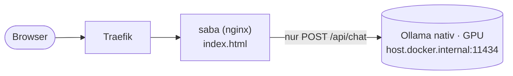

# Saba – einfacher Chat mit lokalem Modell

[← zurück zur README](../README.md)

Eigene Chat-Seite (HTML + JavaScript, nginx) ohne Login. Antworten kommen von [Ollama](https://ollama.com), das nativ unter Windows läuft und die AMD RX 7800 XT nutzt.

- Öffentlich: https://saba.homelab.brandadrian.com
- Lokal: https://saba.localhost



## Dateien

```
saba/docker-compose.yml   nginx + Traefik-Labels
saba/nginx.conf           liefert die Seite, leitet NUR /api/chat an Ollama weiter
saba/html/index.html      Chat-Oberfläche (Streaming, Verlauf nur im Browser)
saba/html/saba.png        Bild von Saba (Porträt, Avatar, Favicon)
saba/Modelfile.saba       Modell "saba" = Basismodell + System-Prompt (Sprachstil)
```

## Starten

1. Ollama für Windows installieren: https://ollama.com/download
2. Modell laden und "saba" erstellen (PowerShell):

```powershell
cd C:\github\homelab-proxy\saba
ollama pull gemma3:27b
ollama create saba -f Modelfile.saba
```

3. Chat starten:

```bash
docker compose up -d
```

Falls der Chat "Fehler 502" zeigt: Windows-Umgebungsvariable `OLLAMA_HOST=0.0.0.0` setzen und Ollama neu starten.

GPU prüfen: `ollama ps` → Spalte `PROCESSOR` sollte `100% GPU` zeigen.

## Sprachstil anpassen

`SYSTEM`-Text in `saba/Modelfile.saba` ändern, dann:

```powershell
ollama create saba -f Modelfile.saba
```

Kein Neustart nötig, gilt ab der nächsten Nachricht. `temperature` höher = verrückter, tiefer = sachlicher.

## Modell

Hardware: AMD Radeon AI PRO R9700 (32 GB VRAM), 32 GB RAM.

| Modell | Grösse | Wofür |
|--------|--------|-------|
| `gemma3:27b` (Standard seit 2026-11-05) | ~17 GB | bestes Deutsch, witziger und kreativer, 100% GPU, ~30 t/s |
| `gemma3:12b` | ~8 GB | kleiner und schneller, etwas flacher im Humor |
| `mistral-nemo` | ~7 GB | Alternative, kreativ/Rollenspiel |

Wechseln: `FROM` im Modelfile ändern, `ollama pull <modell>`, `ollama create saba -f Modelfile.saba`.

## Sicherheit

- Kein Login: jeder mit dem Link kann chatten und deine GPU nutzen.
- Ollama ist nicht direkt erreichbar. nginx leitet nur `POST /api/chat` weiter (kein Modell-Download/-Löschen).
- Limit: 30 Anfragen/Minute insgesamt, max. 64 KB pro Anfrage (`nginx.conf`).
- Der Chatverlauf liegt nur im Browser, auf dem Server wird nichts gespeichert.
