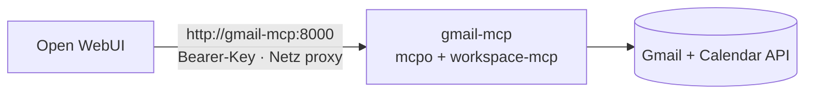

# Gmail + Kalender für Open WebUI

Ein Tool für Gmail und Google Kalender: [workspace-mcp](https://github.com/taylorwilsdon/google_workspace_mcp) (nur `gmail` und `calendar`) hinter [mcpo](https://github.com/open-webui/mcpo), das MCP als OpenAPI anbietet. Ein Container, eine Keys-Datei, ein Google-Login.



Nicht über Traefik veröffentlicht: Der Server hat vollen Zugriff auf Postfach und Kalender.

## Dateien

```
gmail-mcp/docker-compose.yml   mcpo + workspace-mcp
gmail-mcp/.env.example         Vorlage für API-Key, E-Mail, Login-Port
%USERPROFILE%\.gmail-mcp\      gcp-oauth.keys.json + workspace\ (Token, nicht im Git)
```

## Einrichten

1. Google Cloud Console: **Gmail API** und **Google Calendar API** aktivieren. OAuth-Client vom Typ **Desktop-App**, JSON als `%USERPROFILE%\.gmail-mcp\gcp-oauth.keys.json`. Bei Typ Webanwendung `http://localhost:8001/oauth2callback` als Weiterleitungs-URI eintragen. Consent-Screen auf **In Produktion**, sonst läuft das Token nach 7 Tagen ab.
2. `.env` aus `.env.example` erstellen: `MCPO_API_KEY`, `GOOGLE_EMAIL`.
3. Starten: `docker compose up -d`
4. Open WebUI → Admin → Externe Tools → ➕, Typ **OpenAPI**, URL `http://gmail-mcp:8000`, Auth Bearer = `MCPO_API_KEY`.
5. Modell mit Funktionsaufruf = **Nativ**, im Chat das Tool einschalten.

## Google-Login (einmalig)

Beim ersten Aufruf (z.B. "Wie viele ungelesene Mails habe ich?") antwortet das Tool mit einem Google-Link. Link im Browser auf dem PC öffnen, Konto wählen, alle Rechte bestätigen. Google leitet auf `http://localhost:8001/oauth2callback` zurück, das Token landet in `.gmail-mcp\workspace\`. Danach die Frage nochmal stellen.

## Token erneuern

Bei Fehlern wie `invalid_grant`: Ordner `.gmail-mcp\workspace\` löschen, `docker compose restart gmail-mcp`, Login wiederholen.
